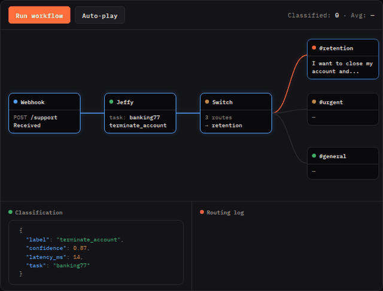

# n8n-nodes-jeffy

n8n community node for [Jeffy](https://jeffyclassify.com) — fast text classification powered by frozen embeddings + logistic regression

Classify text in your n8n workflows using 70+ pretrained classifiers (support tickets, banking intents, sentiment, news topics, emotions, and more) or connect to your own Jeffy server with custom tasks



## Installation

### Self-hosted n8n

1. Go to **Settings → Community Nodes**
2. Enter `n8n-nodes-jeffy`
3. Click Install

Or install manually:

```bash
npm install n8n-nodes-jeffy
```

### n8n Cloud

n8n Cloud only allows installing *verified* community nodes, so this node cannot be installed there yet. Use an **HTTP Request** node pointed at Jeffy instead, which works identically:

- Method: `POST`
- URL: `https://playground.jeffyclassify.com/v1/predict` (or your own server)
- Body (JSON): `{ "text": "{{ $json.message }}", "task": "banking77" }`

The response has `label`, `confidence`, `margin` and `probabilities`, so you can branch on it with a Switch or IF node exactly as with the node. See [examples/cloud-http-router.json](examples/cloud-http-router.json) for an importable workflow with three-tier confidence routing (auto-route, suggest-and-confirm, manual review) plus out-of-scope handling.

Run `GET /v1/capabilities` against whichever server you point at to see which tasks it has loaded. The public playground carries the core set; `support_ticket` and other newer tasks need a self-hosted server on jeffy-classify 0.1.0a16 or later.

## Operations

| Operation | Description |
|---|---|
| **Classify** | Classify a single text input using any pretrained task |
| **Batch Classify** | Classify multiple texts in one request |
| **List Capabilities** | List all available classification tasks on the server |
| **Health Check** | Check if the Jeffy server is running |

## Setup

1. Add a Jeffy node to your workflow
2. Create credentials with your Jeffy server URL (defaults to the public playground at `playground.jeffyclassify.com`)
3. Pick a task from the dynamic dropdown — it fetches available classifiers from your server
4. Pass in text and get back a label + confidence score

## Example: Customer support routing

Connect a webhook or email trigger → Jeffy (task: `banking77`) → route to different teams based on the classification label

**Input:** "I need to cancel my credit card"
**Output:**
```json
{
  "label": "cancel_transfer",
  "confidence": 0.94,
  "latency_ms": 12.3
}
```

## Available pretrained tasks

The public playground includes classifiers for:

- **banking77** — 77 banking intent classes
- **sst2** — binary sentiment (positive/negative)
- **ag_news** — news topic classification (4 classes)
- **emotion** — emotion detection (6 classes)
- **sms_spam** — spam detection (2 classes)
- **clinc_oos** — intent with out-of-scope detection (151 classes)
- **inbox_router** — email routing (work/family/promo/notification)
- And more — use List Capabilities to see all available tasks

## Self-hosting

Jeffy runs anywhere with Python and a CPU — no GPU needed

```bash
pip install jeffy-classify
jeffy-serve
```

Then point the n8n credential Base URL to your server

## Links

- [Jeffy](https://jeffyclassify.com)
- [Playground](https://playground.jeffyclassify.com)
- [GitHub](https://github.com/nicobrenner/jeffy)

## License

MIT
